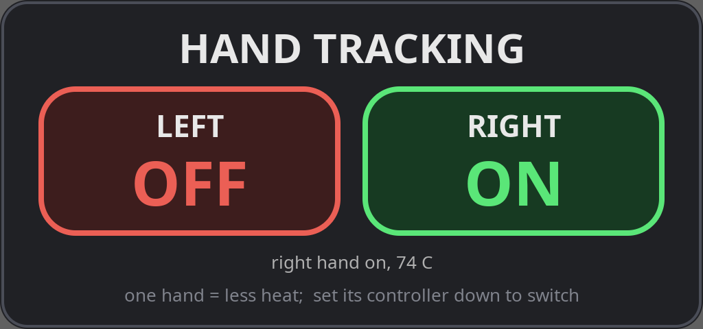

# steam-frame-hand-tracking — optical hand tracking for the Steam Frame

> [!WARNING]
> **Work in progress — and it makes the headset run hot.**
>
> - Hand tracking runs on the Frame's CPU on top of Valve's own streaming and tracking work, which
>   already keeps the CPU at roughly 70–85 °C. With tracking on, the hottest core regularly reaches
>   the high 80s and has hit **93–95 °C**. The headset **rebooted once** under heavy load during
>   development (the cause was not proven).
> - A built-in watchdog stops hand tracking if any CPU sensor stays at **≥ 93 °C for 3 seconds**. It
>   is a safety net, not a guarantee. Track **one hand** where you can (roughly half the work), and
>   watch the temperature on the panel.
> - Tracking is usable but laggy on fast wrist turns, can lose a hand, and may occasionally pick the
>   wrong hand. Heavy load has also caused faint vertical banding in passthrough. See
>   [REPORT.md](REPORT.md).
> - This modifies how SteamVR runs on the headset (a user-level Vulkan layer in the compositor).
>   Use at your own risk.

Use your **bare hands** in PC VR games streamed to the Steam Frame. The Frame's own front
passthrough cameras track your hands; the PC sees them as two Frame controllers (hand pose + finger
skeleton, no buttons). **Set a controller down and that hand takes over; pick it up again and you're
back on the controller.**

- Runs on the Frame itself; camera images never leave the headset, only hand poses (~150 bytes,
  60 times a second) go to the PC.
- Works with Valve's normal Frame streaming. Any app with Frame-controller bindings works.
- Status, measurements and limitations: **[REPORT.md](REPORT.md)**; latest latency work: [LATENCY_REPORT_V2.md](LATENCY_REPORT_V2.md); next research: [RESEARCH_BRIEF_V3.md](RESEARCH_BRIEF_V3.md).

## The panel



Open the SteamVR dashboard on the Frame and click **Hand Tracking** in the bottom bar.

| | |
|---|---|
| **LEFT / RIGHT** | Turn hand tracking on per hand. The first hand on starts the tracker; the last hand off stops it. |
| green **ON** | That hand is tracked and can take over from its controller. |
| red **OFF** | That hand always stays on its controller, and costs nothing. |
| amber **STOPPED** | Enabled, but the tracker isn't running (usually the thermal watchdog). Tap to restart. |
| status line | Which hands are on and the hottest CPU temperature. |

**One hand runs cooler.** A disabled hand isn't processed at all, so one hand is roughly half the
tracking work. The Frame already runs hot while streaming.

## Everyday use

1. Stream a game from the PC as usual.
2. Open the **Hand Tracking** panel and turn on the hand(s) you want.
3. Put that controller down somewhere and leave it, with your hand **up in front of you** where the
   front cameras can see it. After ~1 second the game's controller becomes your hand.
4. Pick the controller up and move it: you're back on the controller immediately.

How loose the set-down / pick-up rules are is in `pcdriver/framehands/framehands_live.ini`
(re-read every second, no restart):

| Setting | Default | Meaning |
|---|---|---|
| `stillSeconds` | 0.8 | how long the controller must lie still |
| `stillCm`, `stillDeg` | 2 cm, 6° | how still "still" is |
| `handAwayCm` | 10 cm | your tracked palm must be at least this far from the controller (a controller held still in your hand never switches) |
| `pickupCm`, `pickupDeg` | 4 cm, 15° | moving the controller this much returns to the controller |

### Smoothing

The wrist/finger smoothing can be changed live with `~/.config/mrhand/profile` (no restart; delete the
file to return to the default). The default favours smooth slow movement with less lag than before.
For the previous, smoothest setting: `cp ~/handtrack/src/tools/profile_smooth_v1.conf ~/.config/mrhand/profile`.
Keys and measurements: [LATENCY_REPORT_V2.md](LATENCY_REPORT_V2.md).

## Troubleshooting

| Symptom | Cause / fix |
|---|---|
| Set the controller down, nothing happens | Is that hand **ON** in the panel? Is your hand in front of you (the cameras see roughly what passthrough shows)? Check `/tmp/live.log`: `hands/run 0.00` means no hand detected. |
| Hand tracking stopped by itself, panel shows STOPPED | Thermal watchdog (≥ 93 °C for 3 s). Let it cool, use one hand, tap to restart. Log: `/tmp/watchdog.log`. |
| Panel says on, PC shows nothing | PC driver not installed / SteamVR not restarted, or wrong `headsetHost` in the ini. The PC SteamVR log (`vrserver.txt`) shows `framehands stats: … packets/s`. |
| Hands wobble / lag on fast turns | Known: see REPORT.md (finger and wrist updates are ~13/s per hand). |

---

## Install

### Headset (in `~/handtrack`, source in `~/handtrack/src` = this repo)

```
# Python venv with mediapipe, opencv-python, numpy, onnxruntime in ~/handtrack/venv
tools/fetch_models.sh                                  # models are downloaded, not in the repo
capture/build.sh && capture/install.sh                 # build camera-sharing Vulkan layer + ptgrab, install the layer
touch ~/.config/mrhand/enable-capture
systemctl --user restart steamvr                       # compositor loads the layer
cp headset/*.sh headset/start_args ~/handtrack/        # start.sh / stop.sh
overlay/install_overlay.sh                             # the Hand Tracking dashboard panel
```

### PC (Windows, VS 2022 Build Tools)

```
pcdriver\build.bat
vrpathreg adddriver <repo>\pcdriver\framehands
```

Set `headsetHost` in `pcdriver\framehands\framehands_live.ini` to the Frame's IP, then restart
SteamVR. The driver DLL can only be replaced while PC SteamVR is closed.

### Removing it

- Headset: panel → both hands OFF (or `~/handtrack/stop.sh`); `capture/uninstall.sh` removes the
  layer; `overlay/install_overlay.sh --remove` removes the panel; `headset/rollback.sh` removes the
  `camera/enableCamera` setting an early probe added.
- PC: `vrpathreg removedriver <repo>\pcdriver\framehands`.

---

## How it works

```
Frame:  passthrough cameras ─▶ vrcompositor ─(our passive Vulkan layer shares the camera buffers)─▶
        ptgrab (GPU downscale, 640² × 2) ─▶ tracker (optical flow 60 Hz + MediaPipe discovery +
        Mercury keypoints) ─▶ UDP hand packets
PC:     framehands SteamVR driver ─▶ two virtual Frame controllers (pose + 31-bone skeleton) ─▶ game
```

- The driver decides per hand when to switch (it sees the real controllers' positions), and reports a
  virtual controller as disconnected while you hold the real one, so apps never pick the wrong one.
- The panel writes the enabled hands to `~/.config/mrhand/hands` (`left`, `right`, `left right` or
  empty); the tracker re-reads it every second and sends the set to the PC in each packet.
- Details: [SYSTEM.md](SYSTEM.md) (architecture), [REPORT.md](REPORT.md) (measurements, latency,
  limitations), [FINDINGS.md](FINDINGS.md) (investigation log),
  [docs/CHANGES_headset.log](docs/CHANGES_headset.log) (headset change log).

| Path | Runs on | What |
|---|---|---|
| `capture/` | Frame | `handcam_layer.cpp`: passive Vulkan layer in vrcompositor that shares the camera buffers (opt-in flag + crash guard). `ptgrab.cpp`: reads them on its own GPU queue, downscales, publishes `/dev/shm/mrhand-pt` |
| `handtrack/` | Frame | the tracker: `live.py` main loop, `fasttrack.py` optical flow, `merctrack.py`/`mercury_kp.py` Mercury keypoints, `detect.py`/`mpworker.py` MediaPipe, `palm.py` pose + UDP bridge, `watchdog.py` |
| `headset/` | Frame | `start.sh`, `stop.sh`, `rollback.sh`, `start_args` |
| `overlay/` | Frame | the Hand Tracking dashboard panel |
| `pcdriver/` | PC | SteamVR driver `framehands` (+ Valve's hand-simulation sample, BSD-3, in `third_party/`), live ini, pose recorder |
| `tools/` | both | telemetry report, replay/ablation harness, validation tests, model fetch |
| `probe/` | Frame | early camera-API probes |

Not in the repo: camera images, recordings and calibration copies (`data/`, they show the room),
models (`tools/fetch_models.sh`; the Mercury model's license is unverified, so it is fetched, not
redistributed), virtual environments, build outputs.

Separate project: the chroma-key passthrough (mr-chroma), not part of this repo.

## License

MIT (see [LICENSE](LICENSE)) for this project's code. `pcdriver/third_party/openvr_handsim` is Valve's
OpenVR SDK sample under its own BSD-3 license (see its NOTICE.md). Models are not included; they
are downloaded by `tools/fetch_models.sh` under their own terms.
